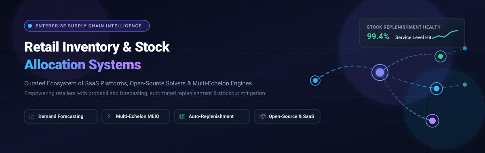

# 🛒 Awesome Retail Inventory & Stock Allocation Systems

<p align="center">
  
</p>

<p align="center">
  <a href="https://github.com/ishandutta2007/Awesome-Awesome-Awesome"></a>
  <a href="https://discord.gg/jc4xtF58Ve"></a>
  <a href="https://github.com/ishandutta2007/Awesome-Retail-Inventory-Stock-Allocation-Systems/stargazers"></a>
  <a href="https://github.com/ishandutta2007/Awesome-Retail-Inventory-Stock-Allocation-Systems/network/members"></a>
  <a href="https://github.com/ishandutta2007/Awesome-Retail-Inventory-Stock-Allocation-Systems/blob/main/LICENSE"></a>
  <a href="https://github.com/ishandutta2007/Awesome-Retail-Inventory-Stock-Allocation-Systems/pulls"></a>
  <a href="https://github.com/ishandutta2007"></a>
</p>

---

## 📌 Executive Summary & Architecture Scope

A curated directory of enterprise **SaaS platforms**, mathematical **solvers**, and production-grade **open-source libraries** for **Retail Inventory & Stock Allocation Systems**. 

Designed for retail planners, supply chain engineers, inventory directors, and developers, this repository benchmarks tools that solve the core inventory allocation dilemma: **deciding what stock to hold where, when to trigger replenishment, and how to allocate units across stores, regional fulfillment hubs, and distribution centers (DCs)**. Modern solutions utilize probabilistic machine learning, weather-demand regression, and **Multi-Echelon Inventory Optimization (MEIO)** to maintain 99%+ on-shelf availability while cutting carrying costs and markdowns.

---

## 📑 Table of Contents

- [📊 Sector Overview & Market Dynamics](#-sector-overview--market-dynamics)
- [🏢 SaaS & Enterprise Hosted Platforms](#-saas--enterprise-hosted-platforms)
- [📦 Open-Source GitHub Projects](#-open-source-github-projects)
- [🔬 Core Mathematical Paradigms](#-core-mathematical-paradigms)
- [🤝 How to Contribute](#-how-to-contribute)
- [⭐ Star History](#-star-history)
- [☕ Support & Community](#-support--community)
- [🛡️ Disclaimer](#-disclaimer)

---

## 📊 Sector Overview & Market Dynamics

The global **retail inventory management and inventory optimization software market** is estimated at **$6.2 Billion to $7.3 Billion in 2025–2026**, expanding at a robust compound annual growth rate (**CAGR of 11.2% to 12.1%**) driven by omnichannel fulfillment complexities, RFID adoption, and AI demand sensing. 

Structurally, the sector is **moderately fragmented**: it is anchored at the Tier-1 enterprise tier by legacy ERP and supply chain heavyweights (such as Manhattan Associates, Blue Yonder, SAP, Kinaxis, and RELEX Solutions), while being vigorously contested by fast-growing AI-native retail allocation specialists (including ToolsGroup, Invent Analytics, Nextail, and Impact Analytics) alongside hundreds of vertical-specific POS and warehouse inventory integrations.

---

## 🏢 SaaS & Enterprise Hosted Platforms

The table below catalogs leading commercial retail inventory allocation and demand replenishment suites. Entities are **ranked in descending order of company size** (market capitalization, enterprise valuation, or annual revenue).

| 🏢 Platform / Vendor | 📈 Company Scale (Valuation / Revenue) | ⚡ Key Allocation & Replenishment Capabilities | 💳 Starting Tier Pricing | 🎁 Free Tier / Trial Terms |
| :--- | :--- | :--- | :--- | :--- |
| **[Manhattan Associates](https://www.manh.com/)** | **$16.5B Market Cap**<br>*(~$1.03B Annual Revenue)* | Manhattan Active Omnichannel Inventory Optimization, unified DC-to-store stock allocation, multi-echelon demand routing, and automated fulfillment logic. | **$2,000 / user / year**<br>*(or ~$500/user/mo on SCALE tier)* | **30-day guided enterprise PoC pilot** scoped with store telemetry and multi-DC test network. |
| **[Sage / Inventory Planner](https://www.inventory-planner.com/)** | **$14.2B Market Cap**<br>*(~$2.8B Annual Revenue)* | Multi-location retail replenishment, automated purchase order creation, sales velocity forecasting, and stockout risk alerts across eCommerce channels. | **$119.99 / month**<br>*(or $1,199/yr for 1,000 SKUs)* | **14-day full-featured free trial** (up to 1,000 SKUs and 2 sales channels; no credit card required). |
| **[Blue Yonder](https://blueyonder.com/)** | **$7.1B Valuation**<br>*(Acquired by Panasonic; ~$1.3B+ Rev)* | Luminate Cognitive demand sensing, multi-echelon network allocation, dynamic replenishment tunnels, and weather-correlated store inventory rebalancing. | **$5,000 / month**<br>*($60,000/yr minimum cloud contract)* | **14-day interactive sandbox demo** and guided PoC simulation with sample warehouse SKU datasets. |
| **[RELEX Solutions](https://www.relexsolutions.com/)** | **$5.7B Valuation**<br>*(~$450M+ ARR; Blackstone-backed)* | Unified store replenishment, Inventory Control AI agent, shelf-space-aware allocation, localized promotions, and fresh-produce spoilage minimization. | **$4,200 / month**<br>*($50,000/yr base tier contract)* | **30-day proof-of-concept (PoC) audit trial** analyzing up to 50 retail stores and 1,000 historical SKUs. |
| **[Zoho Inventory](https://www.zoho.com/inventory/)** | **$5.0B+ Valuation**<br>*(~$1.4B+ Annual Revenue)* | Multi-warehouse stock tracking, automatic reorder point triggers, batch/serial tracking, and real-time synchronization with storefronts and marketplaces. | **$0 / month** *(Free plan)*<br>*(Paid tiers start at $29/mo)* | **Free forever plan**: up to 50 orders/month, 50 shipping labels/month, 1 warehouse location, and 2 users. |
| **[Kinaxis](https://www.kinaxis.com/)** | **$3.1B Market Cap**<br>*(~$450M Annual Revenue)* | Maestro concurrent supply orchestration, continuous multi-echelon inventory optimization (MEIO), what-if scenario modeling, and allocation agility. | **$3,500 / month**<br>*(~$42,000/yr on Planning One tier)* | **30-day guided value assessment pilot** limited to 3 supply chain planner seats and sample SKU network. |
| **[ToolsGroup](https://www.toolsgroup.com/)** | **$250M Valuation**<br>*(~$85M Annual Revenue)* | Decion AI probabilistic demand forecasting for intermittent and long-tail retail items, multi-echelon inventory optimization, and dynamic replenishment tunnels. | **$1,200 / month**<br>*($14,400/yr via Pay-as-You-Grow)* | **30-day interactive simulation pilot** limited to 5 store locations and sample SKU catalog. |
| **[Katana Cloud Inventory](https://ps.katanamrp.com/)** | **$200M Valuation**<br>*(~$30M+ ARR)* | Omnichannel live inventory allocation, automated material and stock replenishment, multi-location tracking, and open API sync with Shopify and ERPs. | **$179 / month**<br>*($1,788/yr billed annually)* | **14-day full-access free trial** with unlimited orders, unlimited SKUs, and all allocation features unlocked. |
| **[Impact Analytics](https://www.impactanalytics.ai/)** | **$150M+ Valuation**<br>*(~$60M ARR; Series C/D)* | ForecastSmart AI forecasting, merchandise financial planning, localized assortment allocation, and dynamic automated store replenishment workflows. | **$2,500 / month**<br>*($30,000/yr starting module)* | **14-day guided proof-of-concept (PoC) evaluation** using up to 100 historical retail SKU data feeds. |
| **[Celect (Nike)](https://www.celect.com/)** | **$110M Acquisition**<br>*(Parent Nike: $51.4B Rev)* | Hyper-localized customer choice modeling, predictive retail store stock distribution, localized size curve allocation, and markdown avoidance algorithms. | **$8,000 / month**<br>*($96,000/yr prior enterprise quote)* | **30-day guided sandbox pilot** with client store-SKU historical transaction logs. |
| **[Slimstock (Slim4)](https://www.slimstock.com/)** | **$100M Valuation**<br>*(~$65M Annual Revenue)* | Slim4 multi-echelon inventory optimization platform, automated purchase order proposals, safety stock calculations, and ABC/XYZ SKU classification. | **$1,500 / month**<br>*($18,000/yr base package)* | **30-day guided inventory audit & simulation trial** evaluating historical stockout frequency and safety stock. |
| **[Invent Analytics](https://invent.ai/)** | **$68M Valuation**<br>*(~$55M Annual Revenue)* | AI-native profit-maximizing stock allocation, dynamic transfer rebalancing between stores, returns positioning, and omni-replenishment optimization. | **$2,000 / month**<br>*($24,000/yr base contract)* | **30-day proof-of-value (PoV) pilot** testing allocation algorithms across up to 10 store or fulfillment nodes. |
| **[Nextail](https://www.nextail.co/)** | **$45M Valuation**<br>*(~$15M ARR)* | AI-powered merchandise planning, first-allocation algorithms for fashion and retail chains, automated inter-store stock transfers, and markdown reduction. | **$1,500 / month**<br>*($18,000/yr starter tier)* | **14-day guided sandbox environment** with pre-loaded retail catalog data and 5 store simulation nodes. |
| **[Finale Inventory](https://www.finaleinventory.com/)** | **$30M Valuation**<br>*(~$18M Annual Revenue)* | Cloud multi-location inventory tracking, dynamic reorder point calculation, barcode scanning, stock allocation, and high-volume eCommerce sync. | **$149 / month**<br>*($1,788/yr billed annually)* | **14-day full-access free trial** (up to 500 orders, unlimited products/SKUs, no credit card required). |

---

## 📦 Open-Source GitHub Projects

A ranked collection of open-source projects, time-series forecasting frameworks, and simulation engines for building custom in-house retail replenishment pipelines. **Ranked in descending order of GitHub stargazers**.

| 📦 Repository & Link | ⭐ GitHub Stars | 🛠️ Tech Stack | 💡 Focus & Inventory Allocation Capabilities |
| :--- | :--- | :--- | :--- |
| **[ERPNext](https://github.com/frappe/erpnext)** | [](https://github.com/frappe/erpnext/stargazers) | Python, JavaScript | Complete enterprise ERP offering automated stock replenishment, multi-warehouse stock allocation, reorder point triggers, batch/serial tracking, and POS sync. |
| **[Google OR-Tools](https://github.com/google/or-tools)** | [](https://github.com/google/or-tools/stargazers) | C++, Python, Java | Fast combinatorial optimization suite used worldwide to formulate and solve Multi-Echelon Inventory Optimization (MEIO), linear programming, and vehicle routing (VRP). |
| **[Darts](https://github.com/unit8co/darts)** | [](https://github.com/unit8co/darts/stargazers) | Python, PyTorch | Unified time-series forecasting library combining statistical baselines (ARIMA, AutoARIMA) and deep learning models (TiDE, TFT, N-BEATS) for retail demand prediction. |
| **[InvenTree](https://github.com/inventree/InvenTree)** | [](https://github.com/inventree/InvenTree/stargazers) | Python, Django, React | Lightweight and extensible open-source inventory management system with stock location trees, minimum stock triggers, batch management, and REST APIs. |
| **[StatsForecast](https://github.com/Nixtla/statsforecast)** | [](https://github.com/Nixtla/statsforecast/stargazers) | Python, Numba, C | Lightning-fast, production-ready statistical forecasting library optimized to compute demand forecasts across millions of SKU-store pairs in minutes (Croston, ETS, AutoARIMA). |
| **[GreaterWMS](https://github.com/GreaterWMS/GreaterWMS)** | [](https://github.com/GreaterWMS/GreaterWMS/stargazers) | Python, Vue, Django | Open-source warehouse management and retail logistics allocation system originating from automotive supply chains, supporting multi-warehouse stock distribution. |
| **[Fleetbase](https://github.com/fleetbase/fleetbase)** | [](https://github.com/fleetbase/fleetbase/stargazers) | PHP, JavaScript, Ember | Modular logistics and supply chain operating system (LSOS) for order orchestration, inventory visibility, and inter-hub dispatch routing. |
| **[NeuralForecast](https://github.com/Nixtla/neuralforecast)** | [](https://github.com/Nixtla/neuralforecast/stargazers) | Python, PyTorch-Lightning | Scalable deep learning forecasting models (Temporal Fusion Transformer, Informer, NHITS, PatchTST) supporting exogenous covariates like weather and promotional calendars. |
| **[OpenBoxes](https://github.com/openboxes/openboxes)** | [](https://github.com/openboxes/openboxes/stargazers) | Java, Groovy, Grails | Enterprise inventory and supply chain management system with stock requisitioning, lot/expiration tracking, and multi-echelon stock movements between facilities. |
| **[HierarchicalForecast](https://github.com/Nixtla/hierarchicalforecast)** [](https://github.com/Nixtla/hierarchicalforecast/stargazers) | Python, NumPy | Probabilistic hierarchical demand reconciliation ensuring coherence across SKU, store, regional distribution center (DC), and national aggregate levels (MinT, Top-Down). |
| **[stockpyl](https://github.com/LarrySnyder/stockpyl)** | [](https://github.com/LarrySnyder/stockpyl/stargazers) | Python | Dedicated Multi-Echelon Inventory Optimization (MEIO) library implementing guaranteed-service (GSM) and stochastic-service (SSM) models directly from supply chain theory. |
| **[BizzAI](https://github.com/orion-ai-community/BizzAI)** | [](https://github.com/orion-ai-community/BizzAI/stargazers) | JavaScript, MERN | Full-stack retail POS and inventory management application featuring real-time stock tracking, low-inventory notifications, and automated billing workflows. |
| **[Stockcast](https://github.com/FilTheo/stockcast)** | [](https://github.com/FilTheo/stockcast/stargazers) | Python | Forecast-to-inventory decision layer that converts raw quantile forecasts into actionable `OrderUpToPolicy` replenishment orders with clock-driven simulation engines. |
| **[Open-Inventory-Manager](https://github.com/SumukhaS291299/Open-Inventory-Manager)** | [](https://github.com/SumukhaS291299/Open-Inventory-Manager/stargazers) | Go, BadgerDB | High-concurrency microservice backend for inventory operations featuring thread-safe in-memory caching, embedded persistent key-value storage, and Docker deployment. |
| **[supplycm](https://github.com/atqatq/supplycm)** | [](https://github.com/atqatq/supplycm/stargazers) | Pure Python | Zero-dependency mathematical library featuring 397 supply chain algorithms covering EOQ/EPQ, Croston intermittent demand forecasting, newsvendor models, and ABC/XYZ analysis. |

---

## 🔬 Core Mathematical Paradigms

Building resilient inventory allocation requires combining distinct mathematical techniques across the supply chain hierarchy:

```
[ External Weather & Promo Signals ] 
                 │
                 ▼
     [ Demand Forecasting Engine ] ────── (StatsForecast / NeuralForecast / Darts)
                 │ (Quantile Forecasts)
                 ▼
[ Multi-Echelon Optimization (MEIO) ] ── (Google OR-Tools / stockpyl)
                 │ (Target Safety Stocks & Service Levels)
                 ▼
[ Replenishment & Order-Up-To Logic ] ── (Stockcast / supplycm)
                 │ (Purchase & Transfer Orders)
                 ▼
 [ Operational ERP & POS Execution ] ─── (ERPNext / InvenTree / GreaterWMS)
```

1. **Probabilistic & Intermittent Demand Forecasting**: Classical point forecasts fail for long-tail retail items. Utilizing **Croston's Method**, Syntetos-Boylan approximations, or DeepAR quantiles allows estimating safety stock based on full probability distributions.
2. **Multi-Echelon Inventory Optimization (MEIO)**: Rather than treating each store in isolation, MEIO models holding costs and lead times across the entire network (Supplier ➔ Central DC ➔ Regional Hub ➔ Store Shelf), preventing bullwhip amplification.
3. **Lateral Transshipment & Rebalancing**: Transferring excess inventory directly between nearby retail stores rather than returning items to central warehouses cuts lead times and avoids costly markdowns.

---

## 🤝 How to Contribute

Contributions from retail technologists, inventory data scientists, and supply chain developers are warmly welcomed:

1. 🍴 **Fork the repository** on GitHub.
2. 🌿 **Create a descriptive feature branch** (`git checkout -b feature/add-new-allocation-platform`).
3. 📝 **Add entries following the established schema**:
   - For SaaS products: Vendor, company scale (valuation/revenue), features, specific starting pricing, and specific free tier/trial limit.
   - For Open-Source projects: Name, link, repository stars badge with `style=social&color=white`, tech stack, and core inventory capabilities.
4. 🚀 **Submit a Pull Request (PR)** with documentation links verifying pricing or functionality.

---

## ⭐ Star History

[](https://star-history.dera.page/#ishandutta2007/Awesome-Retail-Inventory-Stock-Allocation-Systems&type=date&legend=top-left)

---

## ☕ Support & Community

If you find this ecosystem directory helpful for your retail operations, data science modeling, or supply chain architecture, please consider supporting the project:

- ⭐ **Star this repository** on GitHub to help other supply chain practitioners discover it.
- 🍴 **Fork and contribute** your custom algorithms, benchmark scripts, and tool reviews.
- 📢 **Share with colleagues** across retail operations, merchandising, and data engineering.
- ☕ **Support development & maintenance** via the [GitHub Sponsor Dashboard](https://github.com/sponsors/ishandutta2007).

Thank you for contributing to an open, data-driven, and resilient retail supply chain! 🚀

---

## 🛡️ Disclaimer

- This list is **community-curated** for research, benchmarking, and architectural design purposes. It does not constitute commercial endorsement.
- Retail inventory decisions involve significant capital expenditure and risk. Mathematical models, safety stock levels, and automated replenishment policies should always undergo rigorous backtesting against historical retail demand before live production deployment.

---

<p align="center">
  <sub>Maintained with ❤️ by <a href="https://github.com/ishandutta2007">Ishan Dutta</a> and the open-source supply chain community.</sub>
</p>
